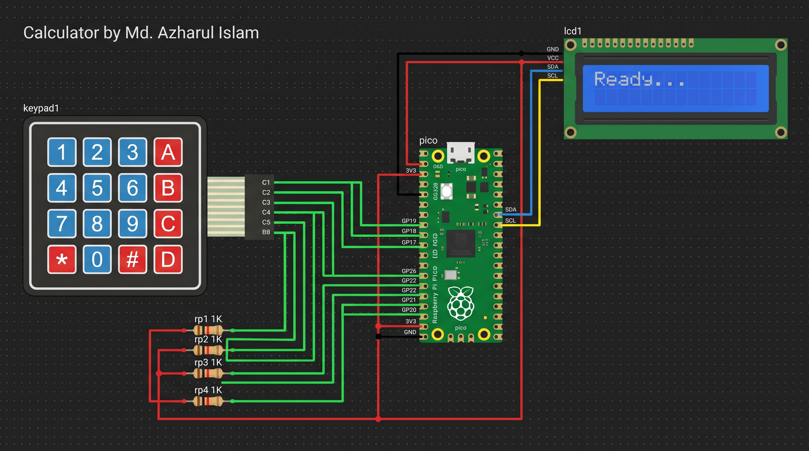

# Raspberry Pi Pico I2C Calculator (C++ / Arduino) 🧮

## 📖 Overview

This project is a fully functional, hardware-based digital calculator powered by the **Raspberry Pi Pico (RP2040)**. It takes user input via a 4x4 membrane keypad and displays operations and results on a 16x2 LCD using the I2C communication protocol. The firmware is written in **C++** utilizing the Arduino framework, demonstrating efficient state machine logic, dynamic string parsing, and hardware peripheral management.

## 🎯 Projects For...

* **Embedded Systems Candidates:** An excellent portfolio piece demonstrating hardware interfacing, I2C protocols, and C++ firmware development for industrial roles.

* **IoT Beginners & Enthusiasts:** A practical project to understand matrix keypad multiplexing and I2C display control within the Arduino ecosystem.

* **Computer Science Students:** A hands-on way to bridge the gap between software logic (state machines, parsing) and physical hardware execution.

## 🛠️ Tech Stack & Components

* **Microcontroller:** Raspberry Pi Pico (RP2040)

* **Firmware Language:** C++ (Arduino Core)

* **Simulation Environment:** Wokwi Simulator

* **Required Libraries:**

  * `Keypad.h` (For matrix scanning)

  * `LiquidCrystal_I2C.h` (For display rendering)

  * `Wire.h` (Native I2C communication)

* **Hardware Components:**

  * 1x 16x2 I2C Character LCD

  * 1x 4x4 Membrane Keypad

  * 4x 1KΩ Resistors (Pull-up configuration for rows)

  * Jumper wires & Breadboard (for physical build)

## ✨ Features

* **Core Operations:** Addition (`+`), Subtraction (`-`), Multiplication (`*`), and Division (`/`).

* **Dynamic String Parsing:** Converts user keystrokes into Arduino `String` objects, converting to `float` for precise mathematical operations.

* **Error Handling:** Safe division by zero detection (`Div by Zero` alert).

* **Continuous Chaining:** Allows the user to continue calculating using the result of the previous operation without clearing the screen.

* **Clear Function:** Instantly resets the state using the `*` (mapped to `C`) key.

## 🔌 Hardware Configuration (Pinout)

### I2C LCD 1602 Wiring

| LCD Pin | Raspberry Pi Pico Pin | Description | 
| ----- | ----- | ----- | 
| GND | GND (Pin 38) | Ground | 
| VCC | 3V3 (Pin 36) | Power (3.3V) | 
| SDA | GP4 (Pin 6) | I2C Serial Data | 
| SCL | GP5 (Pin 7) | I2C Serial Clock | 

### 4x4 Keypad Wiring

*Note: The rows require 1KΩ pull-up resistors connected to the 3V3 rail to ensure stable logic HIGH when keys are not pressed.*

| Keypad Pin | Pico Pin | Type | 
| ----- | ----- | ----- | 
| Row 1 (R1) | GP26 | Input (Pull-up) | 
| Row 2 (R2) | GP22 | Input (Pull-up) | 
| Row 3 (R3) | GP21 | Input (Pull-up) | 
| Row 4 (R4) | GP20 | Input (Pull-up) | 
| Col 1 (C1) | GP19 | Output | 
| Col 2 (C2) | GP18 | Output | 
| Col 3 (C3) | GP17 | Output | 
| Col 4 (C4) | GP16 | Output | 

## 🚀 End-to-End Setup Guide

### Option A: Running in Wokwi Simulator (Web-based)

1. Go to [Wokwi](https://wokwi.com/) and create a new **Raspberry Pi Pico (Arduino)** project.

2. In the `diagram.json` tab, paste the project's JSON configuration.

3. Open the **Library Manager** (the book icon) and add `Keypad` and `LiquidCrystal I2C`.

4. In the `sketch.ino` tab, paste the C++ firmware code.

5. Click the **▶ Play** button. The LCD will initialize, display "Ready...", and await your input.

### Option B: Deploying to Physical Hardware

1. **Install Arduino IDE:** Download and install the latest Arduino IDE.

2. **Install RP2040 Core:**

   * Go to `Tools > Board > Boards Manager`.

   * Search for **Raspberry Pi Pico/RP2040** (by Earle F. Philhower) and install it.

3. **Install Libraries:**

   * Go to `Sketch > Include Library > Manage Libraries`.

   * Search for and install **Keypad** (by Mark Stanley) and **LiquidCrystal I2C** (by Frank de Brabander).

4. **Wire the Circuit:** Connect the physical components exactly as detailed in the Hardware Configuration table above.

5. **Upload the Code:**

   * Select your Pico board and the correct COM port from the `Tools` menu.

   * Paste the provided `sketch.ino` code.

   * Click **Upload**.

## 🧠 Code Explanation

The firmware is structured into standard setup and loop functions, managing three primary logic blocks:

1. **Hardware Initialization (`setup`):**
   The RP2040 has multiple I2C buses. By default, standard Arduino libraries might use different pins. We explicitly remap the I2C pins using `Wire.setSDA(4)` and `Wire.setSCL(5)` before initializing the `LiquidCrystal_I2C` object to ensure it communicates over our specified wiring.

2. **Keypad Matrix Mapping (`Keypad.h`):**
   The 4x4 matrix is mapped to a 2D array. The physical hardware letters (`A`, `B`, `C`, `D`) are mapped virtually in software to our mathematical operators (`+`, `-`, `*`, `/`). The library handles multiplexing (setting columns LOW and reading rows) and debouncing automatically in the background.

3. **The Calculator State Machine (`loop`):**
   The main loop listens for `keypad.getKey()`. It uses Arduino `String` objects (`num1`, `num2`) to append character inputs until an operator is pressed. When `=` is detected, it casts the Strings to `float` using `.toFloat()`, performs the math, handles exceptions (like divide by zero), and updates the UI. The strict RP2040 core requires explicit casting when moving between types, such as `num1 = String(key);`.

## 👤 Author

**Md. Azharul Islam**

* GitHub: [@mdazharulislamnk](https://github.com/mdazharulislamnk)

* LinkedIn: [mdazharulislam](https://www.linkedin.com/in/mdazharulislam/)

*Built to demonstrate proficiency in Embedded Systems, hardware logic, and C++ firmware development.*